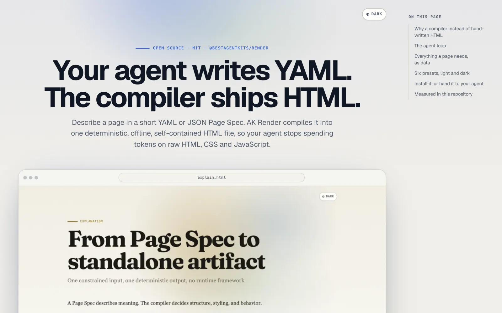

# @bestagentkits/render

A declarative page compiler for coding agents. An agent writes a short YAML or
JSON **Page Spec**; `ak-render` compiles it into one deterministic,
self-contained, interactive **HTML file**.

[](https://render.agentkit.best)

**[render.agentkit.best](https://render.agentkit.best)** · [Gallery](https://render.agentkit.best/gallery/) · [Agent guide](./docs/agent-guide.md) · [npm](https://www.npmjs.com/package/@bestagentkits/render)

Agents describe meaning and composition. The compiler owns HTML, CSS,
interaction, accessibility, responsive layout, theming, fonts, security policy
and byte-for-byte determinism. The agent spends tokens on the content instead
of on markup, and the result looks designed every time.

- **Offline by default.** The file opens from disk (`file://`) and makes zero
  network requests. Fonts are embedded; nothing loads from a CDN.
- **Deterministic.** The same spec and compiler version produce the same bytes.
- **No escape hatch.** A spec cannot carry raw HTML, CSS or JavaScript, so a
  page cannot drift off the design system or smuggle in a script.
- **Local is canonical.** No account, no server, no API key.

## Quick start

Requires Node.js >= 20.11.

1. Write a spec, `plan.yaml`:

   ```yaml
   version: 1
   meta:
     title: Migration plan
     description: How we move the API to the new gateway.
   theme:
     preset: editorial
   blocks:
     - type: hero
       eyebrow: Plan
       title: Migration plan
       description: Move the public API to the new gateway without downtime.
     - type: section
       title: Steps
       blocks:
         - type: steps
           items:
             - title: Mirror traffic
               text: Send a copy of production requests to the new gateway.
             - title: Switch reads
               text: Route read endpoints once error rates match.
     - type: callout
       tone: info
       title: Rollback
       text: Point DNS back to the old gateway; no data migrates.
   ```

2. Validate it, then compile it:

   ```bash
   npx -y @bestagentkits/render validate plan.yaml
   npx -y @bestagentkits/render plan.yaml --out plan.html
   ```

3. Open `plan.html` in any browser. It is one file you can attach, email or
   commit.

## Usage guide

### Find the blocks you need

There are 90 block types in eight categories (layout, content, data,
interaction, media, showcase, engineering, product), from primitives (`section`,
`grid`, `split`, `text`) to semantic blocks that carry the design for you
(`hero`, `steps`, `timeline`, `kpi`, `data-table`, `chart`, `kanban`,
`pricing`, `cta`). Find the ones you need, then read only their contracts:

```bash
ak-render catalog                        # every block by category, and every action
ak-render catalog --category data        # one category
ak-render search-catalog sortable table  # rank block types by intent words
ak-render describe kpi chart --compact   # one line per prop, for several types
ak-render describe timeline --json       # one full contract: defaults, bounds, a11y notes
```

### Icons

Blocks take an `icon` by meaning, never as markup. `icon: gauge` names a
concept and the theme's icon profile decides which pack draws it; `icon:
phosphor:rocket` pins an exact glyph; `icon: { name: gauge, size: lg, label:
Speed }` sets a size (`xs`–`xl`) and an accessible name. Five packs are bundled
as a curated, license-tracked subset (Lucide, Phosphor, Tabler, Pixelarticons,
Codicons); a page embeds only the glyphs it uses, once each, as same-document
SVG symbols, so the output stays offline and deterministic. See
[docs/icons.md](./docs/icons.md).

```bash
ak-render icons search gauge          # English or Vietnamese, up to 8 hits
ak-render icons describe gauge        # packs, variants, license; never SVG
ak-render icons packs                 # bundled packs and their licenses
```

Containers (`section`, `grid`, `split`, `stack` and the page layouts
`sidebar-layout`, `main-aside`, `rail-layout`) take their children under
`blocks:`. Tabs, accordion sections, carousel slides and bento tiles hold
blocks too, under `items[i].blocks`.

Text is plain text, with one exception: in prose props such as `text`, a step's
or list item's `text`, a `description` or a `caption`, a pair of backticks
renders as inline code, so `` `ak-render catalog` `` reads as a command, and a
pair of double asterisks renders as bold, so `**required**` stands out. Block
titles, step, timeline and card titles, table cells, comparison items and
key-value values render the same spans. Nothing else is parsed as markup, an
unpaired marker stays literal, and the document title, code blocks and
terminal lines are never changed. `describe` marks each prose prop.

### Compose a page from an intent

For a common page kind, skip the spec: `compose` takes a typed intent and its
content slots and expands them, deterministically and without a model call,
into an ordinary Page Spec built from existing blocks, then compiles it. The
first intent is `investment-report` (thesis, key facts, metrics, scenario
projections over one shared dataset, risks, milestones and sources). The
expanded spec is yours to keep editing with the full block vocabulary; see
[docs/compose.md](./docs/compose.md).

```bash
ak-render compose intents                                   # intents and their slot schemas (--json)
ak-render compose report.yaml --out report.html --spec-out report.spec.yaml
ak-render compose report.yaml --dry-run                     # print the expanded spec only
```

### Start from a page recipe

A recipe is a complete, valid starter spec for a common page: a dashboard, a
benchmark report, an architecture review, an incident report, a product
showcase, a case study, a release recap, an implementation plan, a research
report or a decision memo. Replace its placeholder text and data, then validate.

```bash
ak-render recipes                          # names, summaries and the blocks each uses
ak-render recipe dashboard > page.yaml     # the starter spec as YAML
```

### Datasets and state

Declare a table once under `datasets` and bind charts, tables and widgets to it
with `dataRef`, reshaped by a bounded `transform` that can also derive ratios,
deltas, percent changes, shares, running totals and a table total row. A `kpi` card
can `cite` the dataset it reports, so the compiler fills the value or warns when
the written value disagrees. Native controls write page
`state`, `visibleWhen` switches views from it, and `filter-bar` filters a table,
board or log. All of it is data, and every page still reads completely with
scripts off. See [docs/data-and-state.md](./docs/data-and-state.md).

### Validate and fix

```bash
ak-render validate plan.yaml --json
```

The result is `{ ok, diagnostics[] }`. Each diagnostic has a stable `code` and
the JSON `path` to fix, such as `$.blocks[1].blocks[0].items[2].title`. Exit
code `1` means "fix and retry"; `2` means the input could not be read or the
output could not be written.

### Compile

```bash
ak-render plan.yaml --out plan.html            # compile is the default command
ak-render plan.yaml --out plan.html --json     # print bytes, hash, features, warnings
ak-render - --out plan.html < plan.yaml        # read the spec from stdin
ak-render plan.yaml --theme blueprint          # override the spec's theme
```

### Themes

Twelve built-in presets, each with a light and a dark scheme and an embedded
display face: `blueprint`, `crimson-press`, `data-console`, `editorial`,
`executive-report`, `newspaper`, `paper-ink`, `product-studio`, `research-notebook`,
`swiss-clean`, `terminal-mono` and `warm-signal`. Presets also choose
component recipes, such as ledger tables or outlined cards, from closed lists.
Pick one under `theme.preset`, or extend one with validated tokens:

```yaml
theme:
  preset: team-theme
  extends: editorial
  tokens:
    color-accent: "#b8860b"
    motion-policy: reduced  # state feedback only; `none` is a still page
```

`ak-render themes` lists the presets it can see, including project and user
presets. See [docs/themes.md](./docs/themes.md).

### Interaction

Tabs, accordions, carousels, native form controls, filter bars, sortable
tables, dialogs, copy buttons and the theme toggle come from a small trusted
runtime. A spec wires them with a closed
set of declarative actions (`ak-render catalog` lists them); there is no
JavaScript field. Every page reads completely with scripts off, with motion
reduced, in print and in a screenshot.

A block can also opt into one named motion recipe, such as
`motion: reveal-soft` or `motion: tabs-slide`. The compiler owns the CSS, the
timing and the reduced-motion fallback; see [docs/motion.md](./docs/motion.md).
`ak-render motions search <intent>` finds a recipe, and `ak-render motion audit
<spec|page.html>` reports motion problems with a rule id, a path and a fix.
`ak-render motion studio page.yaml` opens a local dashboard to inspect, tune,
preview and accept motion changes as a reviewed diff to the spec.

`ak-render audit-ui page.yaml` checks the compiled page itself: the `quick`
preset reads the theme and markup, and `--preset publication` opens it in a
headless Chromium at 375, 768 and 1440 px in light and dark, then no-JS,
reduced motion and print, with every network request blocked. Each finding
names the rule, the block's spec path, the viewport, the evidence and a fix;
see [docs/audit-ui.md](./docs/audit-ui.md).

### Review a plan in the page

End a plan with a `feedback` block and put each open question in a `decision`
block. The reader selects any text, or uses a section's Comment button, to
leave a comment, picks an answer for each decision, and presses **Copy
feedback**. That copies one plain-text prompt with every answer and comment,
each pointing at its section, block or code lines, to paste back to the agent.
Comments survive a reload and reset when the page is recompiled with new
content. Nothing leaves the browser.

```yaml
- type: decision
  question: How do we roll back a failed switch?
  options:
    - label: Flip the routing flag
      recommended: true
    - label: Point DNS back to the old gateway
- type: feedback
```

### Images, video and the network

Local paths (`assets/shot.png`) always work. A remote URL renders as a labelled
fallback with a link unless the spec opts in. A remote video `poster` is the
exception: it has no fallback, so `validate` rejects it at its own path until
the page allows remote `images`:

```yaml
policy:
  network:
    allow: [images, media]
```

The page's Content Security Policy is derived from that policy. See
[docs/media-policy.md](./docs/media-policy.md).

## Use it from an agent

For a page kind `compose` knows, one `compose` call is the whole task. Otherwise
agents follow one loop: find blocks with `catalog` or `search-catalog`, start
from a `recipe` when one fits, `describe --compact` the blocks they use,
`validate` and fix diagnostics by JSON path, then compile. Later edits are
small `patch` calls that address blocks by `id`, not a rewritten spec. The
[agent guide](./docs/agent-guide.md) has the details and [llms.txt](./llms.txt)
is the LLM-facing index.

### Install the agent skill

The `ak-render` skill ([skills/ak-render/SKILL.md](./skills/ak-render/SKILL.md))
teaches an agent that loop.

**Any agent**, with the [skills CLI](https://github.com/vercel-labs/skills):

```bash
npx skills add bestagentkits/ak-render
```

**Claude Code**, as a plugin that also registers the MCP server:

```bash
claude plugin marketplace add bestagentkits/ak-render
claude plugin install ak-render@ak-render
```

**Codex and ChatGPT**, as a plugin:

```bash
codex plugin marketplace add bestagentkits/ak-render
codex plugin add ak-render@ak-render
```

### Three ways to run it

All three serve the same tools with the same contracts, backed by the same
compiler, so a spec renders to the same bytes whichever an agent picks.

| Mode | Needs | `render` returns | Network |
| --- | --- | --- | --- |
| Local CLI | Node 20.11+ | writes `--out`, prints a summary with `--json` | none |
| Local MCP (stdio) | Node 20.11+ | writes `out`, returns a summary | none |
| Remote MCP (Streamable HTTP) | an AgentKit token | stores the page, returns a summary and `artifactUrl` | yes |

Local is canonical and needs no account. The remote server exists for agents
that cannot install Node or need a URL to hand someone.

**Local CLI.** The loop above, with `ak-render` on the path or through `npx`.

**Local MCP over stdio.** `ak-render mcp` serves `catalog`, `search-catalog`,
`describe`, `search-icons`, `describe-icon`, `icon-packs`, `motions`, `recipes`, `recipe`, `validate`, `repair`, `patch`, `audit-motion`, `audit-ui`, `compose`, `render` and `themes` as MCP
tools. `render` and `compose` write the HTML to disk
and returns only a summary, so the page never enters the agent's context.

```json
{
  "mcpServers": {
    "ak-render": { "command": "npx", "args": ["-y", "@bestagentkits/render", "mcp"] }
  }
}
```

**Remote MCP over Streamable HTTP.** `https://render.agentkit.best/mcp` serves
`catalog`, `search-catalog`, `describe`, `search-icons`, `describe-icon`, `icon-packs`, `motions`, `recipes`, `recipe`, `validate`,
`repair`, `patch`, `audit-motion`, `audit-ui` (quick preset only), `compose`, `render` and `themes` with the same contracts. A remote server cannot write into your filesystem, so
`render` and `compose` take no `out`: it stores the page and returns the same summary plus an
`artifactUrl` that lives for one hour, or a share link that lives for 30 days
with `share: true`. The HTML still never enters the agent's context.
Pass `retainSpec: true` to keep the spec beside the page, and call the
remote-only `artifact-export` with the `artifactUrl` for signed, expiring
download URLs of the HTML, a PNG, a PDF or the retained spec, so the page can be
saved and edited locally without its bytes passing through the agent.
```json
{
  "mcpServers": {
    "ak-render": { "type": "http", "url": "https://render.agentkit.best/mcp" }
  }
}
```

The client signs in to agentkit.best through OAuth the first time it connects
and refreshes on its own; a grant in regular use lasts indefinitely, and one
left idle expires after 365 days. For CI or a client without OAuth, send a
personal AgentKit API key (`ck_live_…`) instead, which lasts until revoked:
add `"headers": { "Authorization": "Bearer ${AGENTKIT_TOKEN}" }`.

Details, limits and the REST routes are in
[apps/cloud/README.md](./apps/cloud/README.md).

## Token cost

The compiled page goes to disk, never through the model. What the agent pays
is guidance it reads, the spec it writes, and a one-line summary it reads back.
That agent cost is what AK Render optimizes. The size of the emitted HTML is
not a goal: the file inlines its stylesheet, fonts, icons, diagrams, highlighting
and runtime so it looks designed and works offline without the agent writing any of it.

| Part of a page task | Hand-written HTML | AK Render |
| --- | ---: | ---: |
| Presentation guidance read | 25.0k (baseline mean) | 10.8k (shared contract, skill, catalog, `describe --json`) |
| Written by the agent | 13.9k (median legacy page) | 7.0k (projected spec) |
| Returned into context | the written page is already there | 0.1k (render summary) |
| **Total, estimated** | **38.9k** | **17.9k (−54%)** |

With the compact workflow the agent guide recommends,
`describe <types...> --compact`, the guidance read is 6.1k and the total
13.3k (−66%). The spec written and the summary returned are the same.

- **Benchmarked:** presentation context drops 64–68%, from 23.7k–26.6k tokens
  of AgentKit's legacy HTML guidance to 7.9k–8.5k on the `ak-render` skill
  route: the shared AgentKit contract, the skill, `catalog`, and the
  `describe --json` output of the blocks a task uses
  ([render benchmark](./docs/artifacts/benchmark-render.md)). The `ak:preview`
  diff task (68%) follows AgentKit's reference-loading table directly; the
  explain, brainstorm and plan rows use the `ak-preview` reference set as a
  proxy for their hand-written HTML route.
- **Measured on 12 HTML pages agents wrote in real projects:** a median of 26%
  of each page is visible text; the rest is markup, CSS and script. The
  projected median output saving is 54%. A page that is mostly prose saves
  little or nothing: one of the twelve grew by 32%.
- **Measured with a live model:** the
  [agent A/B baseline](./docs/artifacts/agent-ab-baseline.md) runs the same
  tasks on the existing flow and on the flow with the new tools, and records
  provider-reported tokens, tool calls, repairs, wall time and a 375 px
  overflow check per task, with confidence intervals. With `repair` shipped
  and `compose` not yet, the model never called `repair` and the after arm
  shows no token or wall-time saving; no saving is claimed.
- **Not measured yet:** human-rated output quality.

Characters are measured; tokens are estimated at 4 characters per token. Method
and per-page data: [agent token cost](./docs/artifacts/agent-token-cost.md),
produced by `benchmarks/agent-token-cost.mjs`.

## Design in one screen

```text
Page Spec (JSON/YAML, authored by a model)
   |  parse -> validate -> normalize
   v
internal IR (flat nodes, stable content-derived IDs)
   |  resolve registry -> resolve theme -> render
   v
single self-contained HTML document
   |  collect used assets/runtime features -> assemble -> verify
   v
deterministic artifact (opens from file://, zero network by default)
```

Six decisions define the boundary, argued in
[ADR 0001](./docs/adr/0001-page-spec-compiler-boundary.md):

1. **Page Spec is authoring; the IR is compiler-internal.** The nested,
   model-friendly spec normalizes into a flat node graph with stable IDs for
   rendering, future diff/patch/editor tooling, and MCP surfaces.
2. **Catalog and registry are separate.** `catalog()` is compact and cheap;
   `describe(type)` carries the full contract, and `--compact` one line per
   prop. Discovery stays out of the token
   budget until a block is actually selected.
3. **The interaction runtime is trusted and declarative.** A closed action
   vocabulary, one small event-delegation script, native HTML controls first,
   and only the feature modules a page uses.
4. **Themes are typed data, never CSS.** Built-in presets plus user presets that
   `extends` them. No CSS escape hatch, no CDN fonts.
5. **Local is canonical; cloud is opt-in.** The hosted renderer and the remote
   MCP server reuse the same compiler and tool contracts and are never the
   source of truth.
6. **Optional capabilities arrive as adapters.** Diagrams can delegate to an
   installed diagram compiler; without one, a structured fallback renders.

## Install as a dependency

```bash
pnpm add @bestagentkits/render
```

## Library API

```ts
import {
  render,
  validate,
  normalize,
  catalog,
  describe,
  loadTheme,
} from '@bestagentkits/render';
```

| Export | Purpose | Status |
| --- | --- | --- |
| `VERSION` | Package version, matching `package.json` | Available |
| `RenderError`, `isRenderError` | Stable error codes with JSON path and node ID | Available |
| `render(spec, options)` | Compile a spec to a standalone HTML artifact | Available |
| `validate(spec)` | Report spec diagnostics without rendering | Available |
| `compose(input, options)`, `composeSpec(input)` | Expand a typed intent into a Page Spec, then compile it (or not, with `dryRun`) | Available |
| `composeIntents()`, `composeInputJsonSchema()` | Compose intents with their content schemas | Available |
| `validate(spec, { suggest: true })` | Diagnostics with suggested JSON Patch `fixes` | Available |
| `repair(spec, { mode: 'safe' })` | Apply only semantics-preserving fixes, revalidate, log changes | Available |
| `patch(spec, ops, { baseHash })`, `patchSpecText(text, ops)`, `specHash(spec)` | JSON Patch a spec, blocks addressed as `/blocks/@<id>`, with a content hash for optimistic concurrency | Available |
| `normalize(spec)` | Produce the flat internal IR | Available |
| `catalog(options)` | Compact list of blocks and actions, optionally one `category` | Available |
| `searchCatalog(query)` | Block types ranked by intent words | Available |
| `describe(type)` | Full machine-readable contract for one entry | Available |
| `describeMany(types, options)` | Up to 12 contracts, full or `compact` | Available |
| `recipes()`, `recipe(name)` | Page recipe list, and one recipe's starter spec | Available |
| `motionCatalog()`, `searchMotions(query)`, `describeMotion(id, options)` | Motion recipe list, search and descriptor | Available |
| `auditMotionSpec(spec)`, `auditMotionHtml(html)` | Deterministic motion findings for a spec or a compiled page | Available |
| `loadTheme(input)` | Validate and resolve a theme preset | Available |
| `buildThemeCatalog(options)` | Discover built-in, user, project, and explicit presets | Available |

## CLI reference

```bash
ak-render page.yaml --out page.html
ak-render - --out page.html < page.yaml   # read the spec from stdin
ak-render validate page.json [--suggest]
ak-render compose <input|-> [--out <file.html>] [--spec-out <spec.yaml>] [--dry-run]
ak-render compose intents
ak-render repair page.yaml --out page.yaml   # apply safe fixes only
ak-render patch page.yaml '[{"op":"replace","path":"/blocks/@intro/text","value":"..."}]' [--base-hash <hash>] [--dry-run]
ak-render catalog [--category <c>]
ak-render search-catalog <terms...>
ak-render icons <search <terms...>|describe <icon>|packs>
ak-render describe <type...> [--compact]
ak-render motions [search <terms...>|describe <id...> [--compact]]
ak-render motion audit <spec|page.html|-> [--fail-on <severity>] [--baseline <report.json>]
ak-render motion studio <spec> [--port <n>]  # local motion dashboard
ak-render audit-ui <spec|page.html|-> [--preset <quick|publication>] [--fail-on <severity>]
ak-render recipes
ak-render recipe <name>                   # YAML by default
ak-render themes
ak-render mcp                             # MCP server over stdio

ak-render <command> --help
ak-render --version
```

Every command accepts `--json` and never prompts.

## Fixtures and snapshots

`fixtures/pages/` holds the representative corpus the compiler is built
against: plan, explain, recap, diff, dashboard, media, interactive and theme
showcase pages, one page per widget family, layout, data and theme feature,
and six composition pages (a dashboard, a benchmark report, a research report,
a product case study, a data explorer and an incident report). `fixtures/snapshots/` holds one committed artifact per built-in
preset. See [fixtures/README.md](./fixtures/README.md) and
[docs/themes.md](./docs/themes.md). Fixtures are the specification: a new
capability is not done until a fixture exercises it.

## Repository layout

| Path | Contents |
| --- | --- |
| `src/` | Library and CLI source |
| `tests/unit/` | Vitest unit and contract tests |
| `tests/browser/` | Playwright browser tests, including the zero-network audit |
| `fixtures/` | Representative Page Spec corpus and committed cross-preset snapshots |
| `benchmarks/` | Reproducible measurement harnesses |
| `docs/adr/` | Architecture decision records |
| `docs/artifacts/` | Captured measurements and evidence |
| `skills/`, `.claude-plugin/`, `.agents/plugins/`, `plugin.json`, `mcp.json` | Agent skill and plugin manifests |
| `assets/` | Embedded font licences and the plugin icon (`icon.svg` is the source of `logo.png` and `composer-icon.png`) |
| `site/` | Landing page spec, build script output and Cloudflare config |
| `src/mcp/` | MCP protocol, shared tool contracts, stdio and Streamable HTTP transports |
| `apps/cloud/` | Opt-in Cloudflare renderer: REST routes and the remote MCP endpoint |

## Development

```bash
pnpm install
pnpm verify          # lint, typecheck, font and recipe checks, unit tests, build
pnpm test:browser    # Playwright, after: pnpm exec playwright install chromium
pnpm test:package    # pack, install into a temp project, exercise API and bin
pnpm bench:baseline  # re-run the legacy presentation-context measurement
pnpm bench:spec      # spec compression for the composition fixtures
pnpm bench:agent --model <id> --visual  # live-model A/B; skips without a model API key
pnpm build && pnpm bench:render --agentkit ../agentkit --repeat 9  # committed render artifact
pnpm site:build      # compile the landing page and gallery into site/dist
pnpm site:deploy     # build, then deploy site/dist with wrangler
node scripts/generate-site-images.mjs  # after pnpm build: redraw site icons and social card
```

See [CONTRIBUTING.md](./CONTRIBUTING.md) for the determinism, trust, and testing
rules that changes are reviewed against, and
[docs/release-policy.md](./docs/release-policy.md) for versioning.

## Security

Spec input is untrusted. Report vulnerabilities privately through GitHub's
security advisory flow; see [SECURITY.md](./SECURITY.md) for the threat model and
the invariants the compiler must hold.

## License

MIT — see [LICENSE](./LICENSE).
