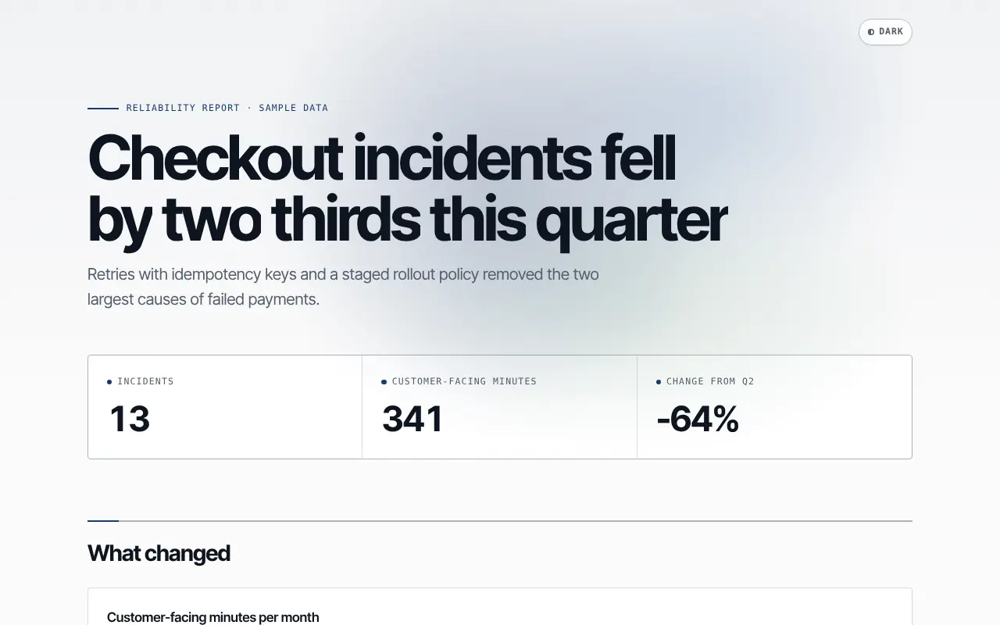
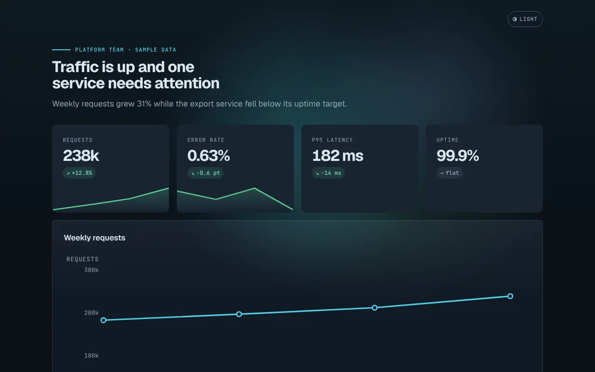
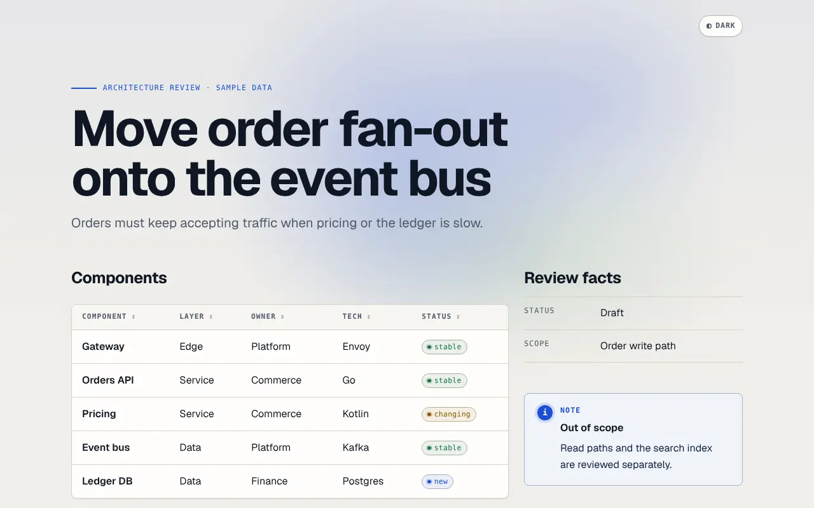

# AK Render for Claude

AK Render turns a report, dashboard or architecture review into one polished,
self-contained HTML page. Claude writes a short YAML Page Spec that describes
what the page says, validates it, and compiles it with the open-source
[`@bestagentkits/render`](https://www.npmjs.com/package/@bestagentkits/render)
compiler. The page opens offline from your disk, makes no network request,
and renders the same bytes every time for the same spec. Claude never
hand-writes HTML, CSS or JavaScript, and the spec has no field that could
inject them.



## Install

In Claude Code 2.1.275 or later:

```bash
/plugin install ak-render --marketplace bestagentkits/ak-render
```

On older versions, add the marketplace first:

```bash
claude plugin marketplace add bestagentkits/ak-render
claude plugin install ak-render@ak-render
```

## What the plugin contains

| Component | What it does |
| --- | --- |
| Skill `ak-render` | Teaches Claude the loop: brief, Page Spec, validate, render, inspect. Includes three example specs (report, dashboard, architecture review). |
| Local MCP server `ak-render` | Runs `npx -y @bestagentkits/render@0.3.0 mcp` on your machine and exposes the tools `catalog`, `search-catalog`, `describe`, `recipes`, `recipe`, `validate`, `render` and `themes`. |

There are no hooks, commands, agents or remote servers.

## Supported surfaces

| Surface | Status | Why |
| --- | --- | --- |
| Claude Code (terminal, IDE, desktop Code tab) | Supported | Loads the skill and starts the local MCP server. The skill can also call the CLI through `npx`. |
| Cowork, session on your computer | Expected to work, not yet verified by the maintainers | Cowork loads skills and local MCP servers when the session runs on your computer, and Node.js 20.11+ must be installed there. |
| Cowork, session not on your computer | Not supported | Local MCP servers don't start, so nothing can render. |
| claude.ai chat (web, desktop chat, mobile) | Not supported | Chat ignores local MCP servers. The skill may load, but it needs a local Node.js runtime to render, so it tells you rather than writing HTML by hand. |

This plugin does not ship or imply a remote renderer. The separately hosted
AK Render service needs an AgentKit account and is not part of this plugin.

## Requirements

- Node.js 20.11 or later, with `npx` on `PATH`.
- Network access to the npm registry the first time `npx` fetches
  `@bestagentkits/render@0.3.0`. After that, compiling is fully offline.

If Node is missing or too old, the MCP server fails to start and the skill
tells you to install Node.js; it does not fall back to hand-written HTML.

## Try it

Copy one of these prompts into Claude Code after installing the plugin:

1. "Turn the results of this conversation into an HTML report with AK Render:
   a headline finding, three key numbers, a timeline of what changed and the
   open risks."
2. "Make an AK Render dashboard page from `metrics.csv`: KPIs for the latest
   week, a weekly trend chart and a service table I can filter by status."
3. "Write an architecture review page with AK Render for the service in this
   repository: components, request flow, trade-offs and a risk matrix."
4. "Render this incident postmortem as an offline HTML page with AK Render and
   tell me where the file is."

Claude validates the spec, fixes every diagnostic, writes the `.html` file and
reports its path, size and content hash.





The screenshots show the bundled example specs, which use fictional sample
data.

## What runs, what is sent, and privacy

- **What runs:** `npx` downloads the pinned package `@bestagentkits/render@0.3.0`
  and its one runtime dependency from the npm registry, then runs it as a local
  process. The package version is pinned so the skill text and the compiler
  always match; its own dependencies resolve when npm installs it.
- **What is sent:** nothing from your specs or pages. The compiler reads specs
  and writes HTML on your machine, needs no account, and makes no network
  request. The only network traffic is the npm download.
- **What the page does:** the emitted HTML contains no remote fonts, scripts or
  images unless your spec opts in through `policy.network`, and it never runs
  page-authored JavaScript.
- **Data:** the plugin collects no telemetry and stores nothing outside the
  files you ask it to write.

## Output guarantees

- **Offline:** the page opens from `file://` with zero network requests.
- **Deterministic:** the same spec and compiler version produce identical bytes.
- **Safe input:** spec input is treated as untrusted. Raw HTML, CSS, JavaScript,
  iframes and `javascript:` links are rejected at validation.
- **Readable everywhere:** pages read fully without JavaScript, with reduced
  motion and in print.

## Support

- Documentation and source: <https://github.com/bestagentkits/ak-render>
- Issues: <https://github.com/bestagentkits/ak-render/issues>
- Security reports: use private vulnerability reporting, as described in
  <https://github.com/bestagentkits/ak-render/blob/main/SECURITY.md>
- Website: <https://render.agentkit.best>

## License

MIT. See [LICENSE](LICENSE).
